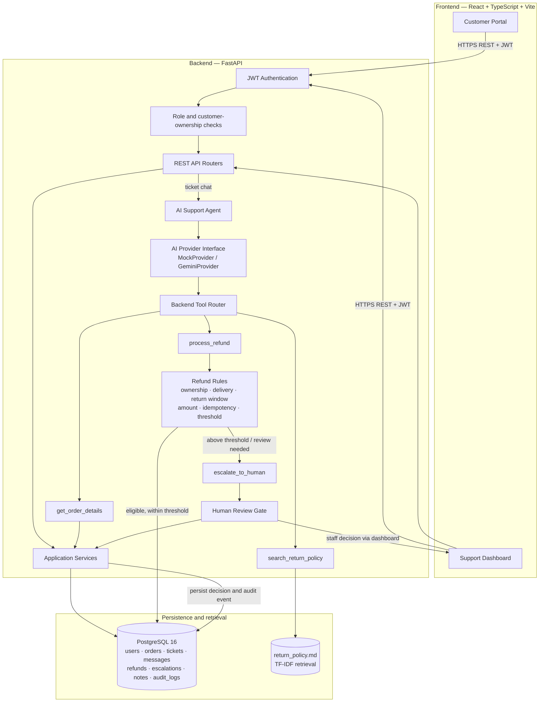
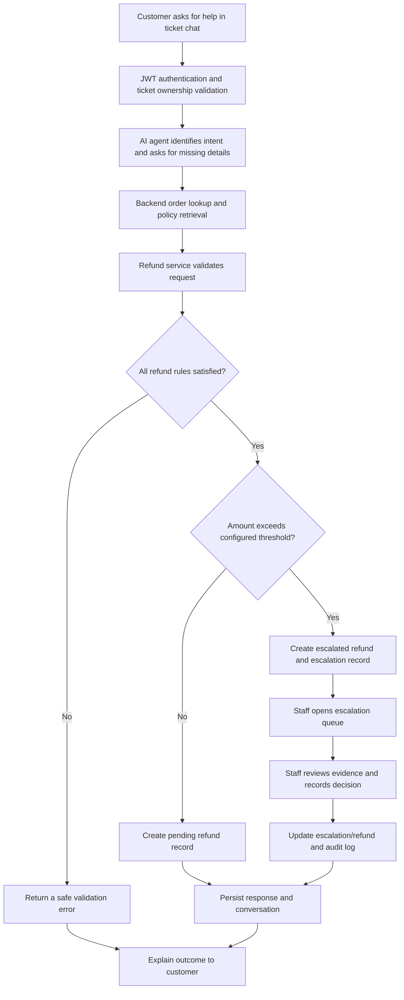

# System Architecture

## Component and request-flow diagram

The following Mermaid diagram can be rendered directly by GitHub. It covers both the automated customer journey and the staff human-review path.



## Application components

| Component | Responsibility |
|---|---|
| Customer Portal | Registration/login, orders, support tickets, AI chat, refund status |
| Support Dashboard | Staff ticket queue, ticket details, internal notes, escalation decisions |
| FastAPI routers | HTTP boundary for authentication, orders, tickets, messages, refunds, and support actions |
| JWT/RBAC dependencies | Authenticate users and enforce customer/staff permissions |
| Application services | Implement ticket, order, refund, escalation, authentication, and audit behavior |
| AI Support Agent | Uses provider abstraction and routes supported support tasks to backend tools |
| Policy retrieval | Searches the local return policy document with TF-IDF |
| PostgreSQL | Persists users, orders, tickets, messages, refunds, escalations, notes, and audit logs |
| Human review | Staff examines escalated records and records the decision through protected support endpoints |

## Refund request and human-review flow



The current configured default threshold is 500000 paise (₹5,000). The backend owns this rule; it is not trusted from a customer request or generated by the model. The code distinguishes the exact threshold from values above it.

## Existing high-level architecture (text view)

```
Customer Portal / Support Dashboard
              |
         REST + JWT
              |
     FastAPI Routers + RBAC
              |
       Application Services
        /      |       \
       /       |        \
   PostgreSQL  AI Agent  Audit Log
                 |
            Tool Router
           /    |     \
       Orders Policy  Refund
              Retrieval  |
                        Escalation
                            |
                       Staff Review
                            |
                       Audit + DB
```

## Security layers

1. **Transport:** use HTTPS in deployed environments.
2. **Authentication:** JWT bearer token on protected routes.
3. **Authorization:** customer-only and staff/admin role dependencies.
4. **Object ownership:** customer resource lookups are scoped to the authenticated user.
5. **Input validation:** Pydantic request schemas validate API input.
6. **SQL access:** SQLAlchemy ORM queries.
7. **AI safety boundary:** system instructions and user content are separated; customer identity and business rules are determined by backend context, not by model-generated claims.
8. **Refund controls:** backend checks ownership, delivery state, return window, amount, duplicate/idempotency rules, and escalation threshold.
9. **Auditability:** sensitive refund/escalation actions create audit records.

## Notes and limitations

- `AI_MOCK_MODE=true` is the deterministic default used in the recorded verification.
- Gemini integration is available through the provider interface but requires a valid key and a separate live-provider verification.
- Refunds are simulated application records. The project does not connect to a payment processor or transfer funds.
