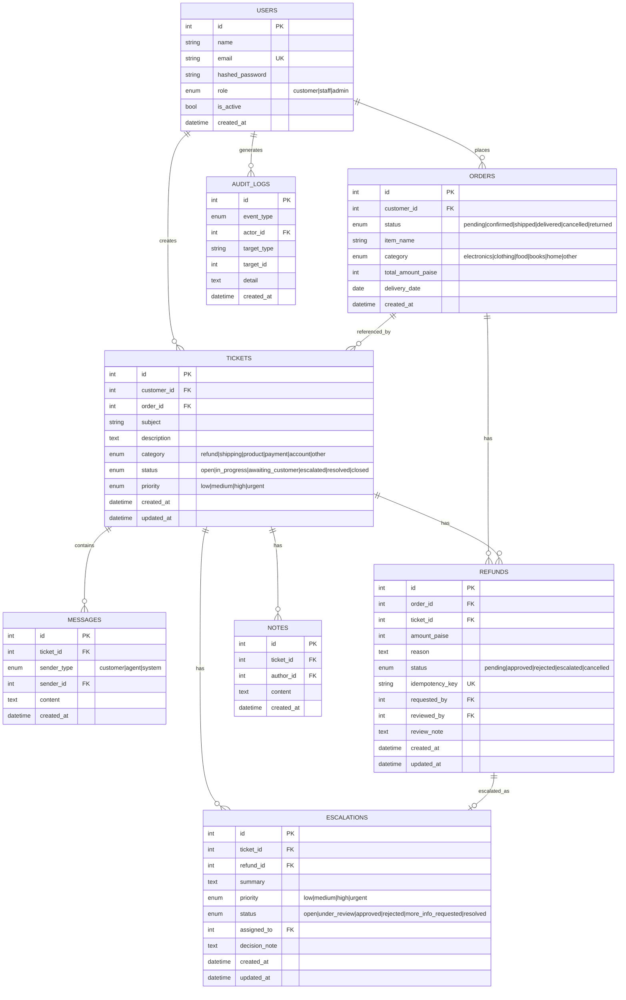

# Database Schema (ER Diagram)

## Entity Relationship Overview

## Key Constraints

| Table | Constraint | Purpose |
|-------|-----------|---------|
| `users.email` | UNIQUE | Prevent duplicate accounts |
| `refunds.idempotency_key` | UNIQUE | Prevent duplicate refund processing |
| `orders.customer_id` | FK → users | Ownership link |
| `tickets.customer_id` | FK → users | Ownership link |
| `refunds.requested_by` | FK → users | Audit: who requested |
| `refunds.reviewed_by` | FK → users | Audit: who approved/rejected |
